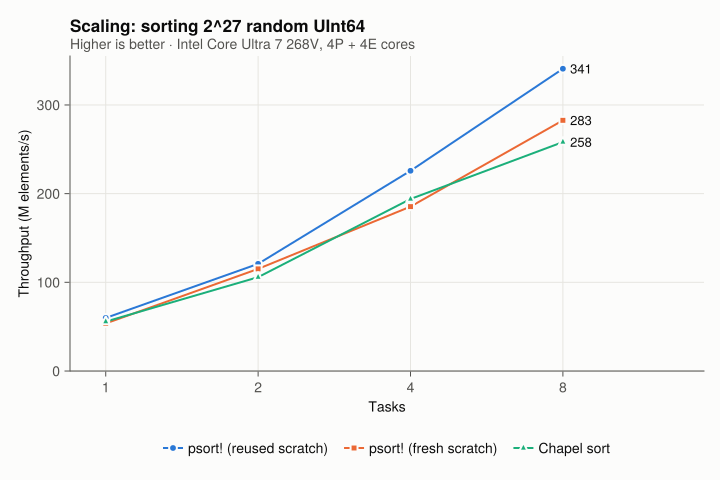
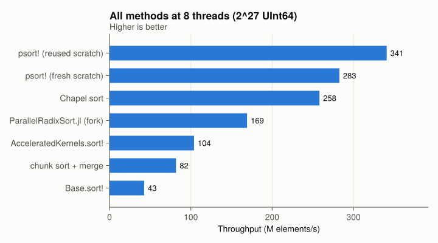
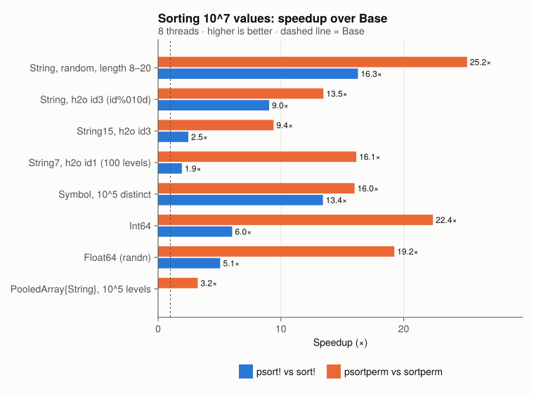

# ChapelSort.jl

Experimental parallel sort for Julia, modelled on the Chapel standard library
sort described in
[“Standard Library Sorting Performance”](https://chapel-lang.org/blog/posts/std-sort-performance/)
(2^27 random `UInt64` in 0.25 s on a 16-core Ryzen 7950X).

```julia
using ChapelSort
psort!(v)                          # in place, uses Threads.nthreads() tasks
psort(v; rev = true, by = first)   # copy; `by` must return a radix-sortable value
psort!(v; ntasks = 4, scratch = s) # reuse a scratch vector (same axes/eltype)
psortperm(v)                       # stable, like sortperm
psortperm((a, b, c); rev = [true, false, false])   # lexicographic over columns
psortperm!(idx, (a, b))            # stably reorder given row indices
sort(v; alg = ChapelSortAlg())     # as a Base.Sort.Algorithm
```

DataFrames joins, grouping and `sort!(df, cols; alg = ChapelSortAlg())` live in the
companion package [ParallelDataFrameOps.jl](../ParallelDataFrameOps.jl), which is
MIT licensed and built on this one.

**How it works:** [docs/ALGORITHM.md](docs/ALGORITHM.md) describes the algorithms
in enough detail to reimplement them, with references and the deviations from
Chapel's design.

Supported keys, all ordered exactly as `isless` and sorted **stably**:
- `Base.BitInteger`, `Bool`, `Char`, `Float32`, `Float64` (`-0.0 < 0.0`, NaNs last).
- `String`, `SubString{String}`, `Symbol`: byte-wise MSD radix with an "end of
  string" bucket, so embedded `\0`, non-ASCII and invalid UTF-8 are all fine.
- InlineStrings (extension): `String1/3/7/15` are radix sorted by their raw bits,
  since their `isless` is unsigned integer comparison. Wider types go byte-wise.
- `PooledArray` (extension, for `psortperm` and multi-column sorts): sort the
  small pool, then radix sort the integer ranks.

Other types, and custom `lt`, fall back to Base. To add a type, extend
`ChapelSort.radixkey` and `ChapelSort.isradixable`, or `ChapelSort.isbytestring`
and `ChapelSort.strbucket`.

## Algorithm (Chapel's `TwoArrayPartitioning` + `MSBRadixSort`)

In short (details, notation and references in [docs/ALGORITHM.md](docs/ALGORITHM.md)):

The algorithm is an out-of-place MSD radix sort with 8-bit digits and one scratch array:

1. **Parallel bucketize** of a large range, by one digit from `A` into `Scratch`:
   - Each of `ntasks` contiguous blocks counts its digits.
   - A bin-major prefix sum over the `256 × ntasks` counts gives every (bin, task)
     pair a private output region.
   - Each task scatters its block with no locks or atomics.
2. **Skip-ahead**: if all keys share the digit, try the next one without moving data.
3. Buckets still larger than `max(n/ntasks, 4096·ntasks)` are bucketized again in
   parallel, in the opposite direction.
4. All other buckets become **small tasks**. They are processed largest first by a
   pool of tasks that pull from an atomic counter. Each one copies back if needed,
   then runs a serial two-array MSD radix sort, with insertion sort for ≤ 48
   elements.

Inputs below 50 000 elements (or `ntasks = 1`) use the serial sort directly.

Why chunk-sort + merge doesn't keep up:
- The final merges are bandwidth bound and poorly parallel.
- Each element is moved `log2(ntasks)` extra times.
- The chunk sorts compare instead of radix-sorting.

## Results

2^27 random `UInt64` (1 GiB), mean of 5 runs, on an Intel Core Ultra 7 268V laptop
(4 performance and 4 low-power efficiency cores) with Julia 1.13.1 and Chapel 2.10.0.
Chapel's `sort` allocates its scratch array on every call, so the fair comparison is
`psort!` with a *fresh* scratch array.





| Method (8 threads)                | Time (s) | M elem/s |
|-----------------------------------|---------:|---------:|
| `Base.sort!` (serial)             |    3.043 |     44.1 |
| chunk sort + parallel merge       |    1.946 |     69.0 |
| `AcceleratedKernels.sort!`        |    1.421 |     94.4 |
| Chapel 2.10 `sort`                |    0.520 |    258.2 |
| `psort!`, fresh scratch           |    0.451 |    297.6 |
| `psort!`, reused scratch          |    0.376 |    356.6 |

| Tasks | Chapel `sort` (s) | `psort!` fresh (s) | `psort!` reused (s) |
|------:|------------------:|-------------------:|--------------------:|
| 1     | 2.409             | 2.289              | 2.137               |
| 2     | 1.268             | 1.185              | 1.076               |
| 4     | 0.692             | 0.640              | 0.597               |
| 8     | 0.520             | 0.451              | 0.376               |

Run-to-run noise on this laptop is ±10–15%.

Floats are converted in place to unsigned keys, sorted as integers, and converted
back. This costs two cheap parallel passes. Computing the float key on every pass
instead made `Float64` 30–40% slower.

### Strings, symbols and sortperm

From `bench/strings.jl`: 10^7 values, 8 threads, best of 3, against Base `sort!`/`sortperm`.



| Values (10^7)                     | `sort!` | `psort!` | × | `sortperm` | `psortperm` | × |
|-----------------------------------|--------:|---------:|--:|-----------:|------------:|--:|
| `String`, random, length 8–20     | 5.13 s | 0.315 s | 16.3 | 11.48 s | 0.456 s | 25.2 |
| `String`, h2o id3 (`id%010d`)     | 2.70 s | 0.299 s |  9.0 |  6.22 s | 0.462 s | 13.5 |
| `String15`, h2o id3               | 0.260 s | 0.106 s | 2.5 |  1.74 s | 0.185 s |  9.4 |
| `String7`, 100 levels             | 0.068 s | 0.035 s | 1.9 |  1.36 s | 0.084 s | 16.1 |
| `Symbol`, 10^5 distinct           | 1.32 s | 0.098 s | 13.4 |  3.93 s | 0.246 s | 16.0 |
| `Int64`                           | 0.234 s | 0.039 s | 6.0 |  1.59 s | 0.071 s | 22.4 |
| `Float64` (randn)                 | 0.235 s | 0.047 s | 5.1 |  1.57 s | 0.081 s | 19.2 |
| `PooledArray{String}`, 10^5 levels | — | — | — | 0.174 s | 0.054 s | 3.2 |

- InlineStrings already ship a fast serial LSD radix sort for `sort!`. For
  `PooledArray`, PooledArrays already does sort the pool, then counting-sort, serially.
  Both are smaller wins.
- `psortperm` sorts (key, index) records with the same radix machinery. Keys of up
  to 32 bits are packed with the index into one `UInt64`.

### Reproducing

```sh
bench/chapel/run.sh 27 5                              # needs `chpl`; writes bench/results/chapel.csv
julia -t 8 --project=bench bench/bench.jl 27 5        # writes bench/results/julia.csv
julia -t 8 --project=bench bench/strings.jl 1e7 3     # writes bench/results/strings.csv
julia --project=bench bench/plots.jl                  # AlgebraOfGraphics → docs/*.svg
```

Sizes are chosen for a 16 GB machine: 2^27 `UInt64` is 1 GiB, plus 1 GiB of scratch.

## Implementation notes / lessons

- The key extractors (`Fwd`, `Rev`) must **not** subtype `Function`. If they do,
  Julia does not specialize functions that only pass them along. That boxed values
  in the recursion and made the sort about 1.5× slower overall.
- Count arrays are indexed as `counts[bin, col]`, not through views. A view that stays
  alive across a recursive call is heap allocated.
- Write-combining scatter buffers (the IPS²Ra trick) were *slower* than a plain
  scatter on this machine, so they are not used.
- Allocating the scratch array costs about 0.09 s per GiB in page faults. Pass
  `scratch` to reuse it.
- A captured variable that is assigned more than once (for example in two `if`
  branches) is boxed by Julia's closure lowering. Inside the parallel `do` blocks
  this cost 10–20×, which happened twice (float keys, group indices). The fix is a
  function barrier.
- One core with an interface for keys (`nbuckets`, `maxlevel`, `bucket`,
  `recurse`, `keylt`) serves fixed-width keys (256 buckets) and strings (257
  buckets, unbounded depth). The fixed-width path compiles to the same code as before.

## Ideas not yet done

- A sample-sort bucketizer (splitters + branchless search) for arbitrary `lt`.
- Strings: cache 8 key bytes per record so each level doesn't chase a pointer per
  string.
- `missing` keys in `psort!`/`psortperm` (sorted last). Today they only work through
  `PooledArray` or the Base fallback.

- Precomputed keys for expensive `by` functions.
- Running big-bucket partitions concurrently instead of one at a time.

## License

ChapelSort.jl is licensed under the [Apache License 2.0](LICENSE). It is an
independent Julia reimplementation of the design of the
[Chapel](https://github.com/chapel-lang/chapel) standard library sort (Copyright
2020-2026 Hewlett Packard Enterprise Development LP, Copyright 2004-2019 Cray Inc.,
Apache-2.0) and contains no Chapel source code. [NOTICE](NOTICE) lists the files
that follow Chapel's design, each of which carries a notice of modification.
